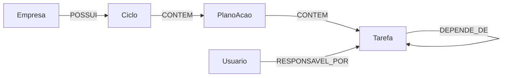

# 🕸️ ACTA no Neo4j

Material de modelagem que representa um recorte do ACTA como grafo no Neo4j e demonstra consultas Cypher para percorrer dependências entre tarefas.

## 📌 Visão geral

O projeto documenta um exemplo concentrado no fluxo Empresa → Ciclo → Plano de ação → Tarefa, com usuários responsáveis e tarefas que dependem de outras. O recorte mostra como percorrer pré-requisitos encadeados e identificar responsáveis por atividades que bloqueiam uma tarefa crítica.

O Neo4j é apresentado como complemento ao modelo relacional do ACTA. O banco PostgreSQL continua adequado para agregações e indicadores; a view [`pdca.vw_dependencias_tarefas`](https://github.com/AppActa/acta-database/blob/main/sql/005_recursive_ctes.sql) demonstra a navegação recursiva equivalente no SQL.

Este repositório contém documentação, comandos Cypher e imagens de evidência. Não contém uma aplicação ou processo automatizado de sincronização entre PostgreSQL e Neo4j.

## ✨ Capacidades

| Área | Conteúdo |
| --- | --- |
| Modelo do grafo | Nós `Empresa`, `Ciclo`, `PlanoAcao`, `Tarefa` e `Usuario`, com as relações que compõem o fluxo PDCA. |
| Dependências | Relação autorreferenciada `DEPENDE_DE` e caminho variável para consultar pré-requisitos em vários níveis. |
| Pergunta de negócio | Consulta os pré-requisitos ainda não concluídos de uma tarefa crítica e encontra seus responsáveis. |
| Evidências | Diagrama do grafo e capturas dos resultados das consultas Cypher. |

## 🔗 Modelo do grafo



A direção de `DEPENDE_DE` parte da tarefa bloqueada e aponta para seu pré-requisito. Assim, a partir de uma tarefa como `Auditoria`, a traversal pode encontrar requisitos diretos e indiretos e consultar quem responde por cada um.

## 🛠️ Tecnologias

| Tecnologia | Uso |
| --- | --- |
| Neo4j | Armazenamento do grafo usado no exemplo documentado. |
| Cypher | Criação dos nós e relações e consultas de traversal. |
| PostgreSQL e SQL recursivo | Modelo relacional de referência para a navegação por dependências no ACTA. |

O material não fixa versões dessas tecnologias nem inclui configuração de instalação.

## 🚀 Como reproduzir

É necessário ter uma instância Neo4j disponível. O repositório não provisiona o serviço; escolha a versão e a forma de execução adequadas ao seu ambiente.

1. Abra [`acta-neo4j.md`](acta-neo4j.md) e execute o bloco **Código Cypher de criação** uma vez em um banco de demonstração vazio. O comando usa `CREATE`, então executá-lo novamente cria outro conjunto de nós e relações.
2. Execute as consultas **Query de traversal: cadeia completa** e **Query de traversal: resposta à pergunta de negócio** no mesmo banco.
3. Compare os resultados com as imagens da pasta [`evidencias/`](evidencias/).

Os dados apresentados são exemplos de demonstração; eles não são importados do banco ACTA nem sincronizados com ele.

## 📚 Documento e evidências

O documento [`acta-neo4j.md`](acta-neo4j.md) detalha as entidades, as relações, o comando de criação, as duas consultas e a interpretação da pergunta de negócio. A pasta [`evidencias/`](evidencias/) contém o diagrama e capturas dos resultados.

## 📁 Estrutura

```text
.
├── acta-neo4j.md             # modelagem, Cypher e interpretação das consultas
├── evidencias/
│   ├── Modelagem.png
│   ├── Query_traversal_1.png
│   └── Query_traversal_2.png
├── LICENSE
├── PULL_REQUEST_TEMPLATE.md
└── README.md
```

## 🤝 Links e autoria

- [Repositório](https://github.com/amandaandrade9410/acta-neo4j) · [Licença MIT](LICENSE) · `acta.institutojef@gmail.com`
- Contribuições: use *issues* e *pull requests*; há um [PULL_REQUEST_TEMPLATE.md](PULL_REQUEST_TEMPLATE.md).
