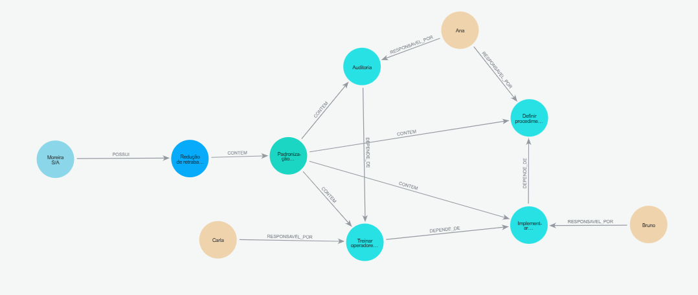
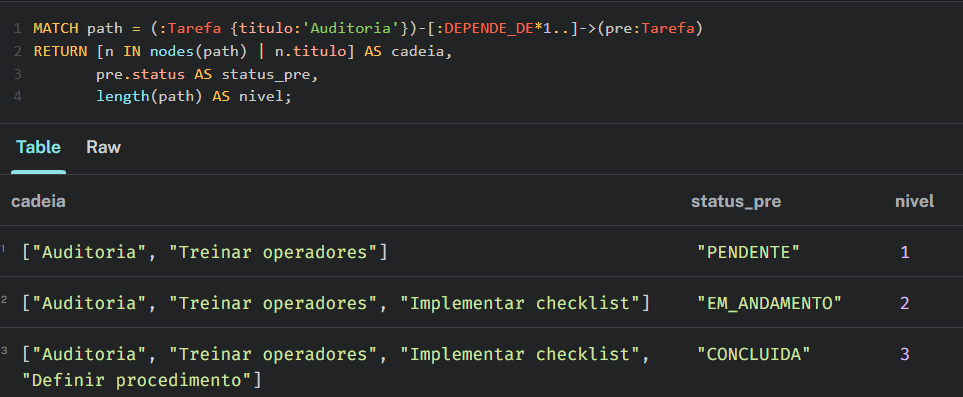
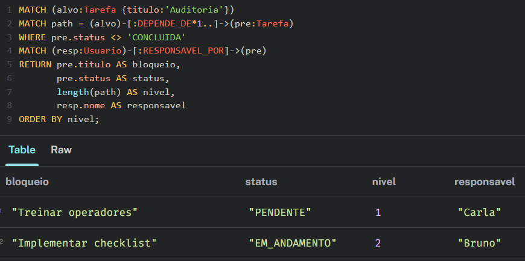

# Modelagem do ACTA como grafo no Neo4j

## 1. Contexto

O ACTA é uma plataforma de melhoria contínua baseada no ciclo PDCA. Seu banco relacional possui entidades como empresas, ciclos, planos de ação, tarefas, usuários, problemas, metas e treinamentos.

Para a modelagem das principais entidades, foi escolhido o núcleo operacional composto por:

- Empresa;
- Ciclo;
- Plano de ação;
- Tarefa;
- Usuário.

O recorte é intencionalmente curto. Ele reproduz apenas o fluxo principal do ACTA e já traz um caso em que a traversal é necessária: a cadeia de dependências entre tarefas.

---

## 2. Por que representar o ACTA como grafo

O Neo4j não substitui o PostgreSQL em todas as consultas do ACTA.

Consultas de agregação, como as abaixo, continuam mais naturais em SQL:

- total de tarefas;
- taxa de conclusão;
- tarefas por empresa ou setor;
- indicadores do dashboard.

O grafo é adequado para relações que formam cadeias e hierarquias. No ACTA, uma tarefa pode depender de outra tarefa, que por sua vez depende de uma terceira, e assim por diante. A pergunta passa a ser sobre o caminho entre as tarefas, e não apenas sobre os dados de uma tarefa isolada.

No banco SQL do ACTA, essa navegação já existe na view `pdca.vw_dependencias_tarefas`, que precisa de `WITH RECURSIVE`, um array `caminho` para registrar o percurso. No Neo4j, a mesma navegação é expressa por um padrão de caminho variável:

```cypher
[:DEPENDE_DE*1..]
```

Assim, o grafo complementa o modelo relacional:

> SQL responde melhor a perguntas de agregação, como “quanto?”. O grafo facilita perguntas de conexão, como “o que depende de quê?” e “quem precisa agir?”.

---

## 3. Modelo de nós

No Neo4j, os nós representam as entidades e elas possuem *labels* para indicar seu tipo. Cada nó também possui propriedades, como `id`, `nome`, `status` e `prioridade`.

### Empresa

Representa a organização à qual o ciclo pertence.

```text
id: 1
nome: Moreira S/A
setor: Segurança
status: ATIVO
```

### Ciclo

Representa o ciclo PDCA que organiza a melhoria.

```text
id: 1
titulo: Redução de retrabalho na linha 3
status: EXECUCAO
```

### PlanoAcao

Representa o plano de ação associado ao ciclo.

```text
id: 1
nome: Padronização de setup
status: EM_EXECUCAO
prioridade: ALTA
```

### Usuario

Representa as pessoas responsáveis pela execução das tarefas.

| id | nome  | tipo        |
| -: | ----- | ----------- |
| 10 | Ana   | GESTOR      |
| 11 | Bruno | COLABORADOR |
| 12 | Carla | COLABORADOR |

### Tarefa

Representa uma atividade do plano. Foram criadas quatro instâncias de `Tarefa` para formar uma cadeia de dependências com três níveis:

| id | título               | status       | prioridade | responsável |
| -: | --------------------- | ------------ | ---------- | ------------ |
|  2 | Definir procedimento  | CONCLUIDA    | ALTA       | Ana          |
|  3 | Implementar checklist | EM_ANDAMENTO | ALTA       | Bruno        |
|  5 | Treinar operadores    | PENDENTE     | MEDIA      | Carla        |
|  4 | Auditoria             | PENDENTE     | CRITICA    | Ana          |

---

## 4. Relações do modelo

As relações conectam os nós e têm direção e nome:

```text
(Empresa)-[:POSSUI]->(Ciclo)
(Ciclo)-[:CONTEM]->(PlanoAcao)
(PlanoAcao)-[:CONTEM]->(Tarefa)
(Usuario)-[:RESPONSAVEL_POR]->(Tarefa)
(Tarefa)-[:DEPENDE_DE]->(Tarefa)
```

A relação `DEPENDE_DE` é autorreferenciada: conecta uma tarefa a outra tarefa.

A direção escolhida significa:

```text
Auditoria
  DEPENDE_DE
    Treinar operadores
      DEPENDE_DE
        Implementar checklist
          DEPENDE_DE
            Definir procedimento
```

Ou seja, a seta sai da tarefa que depende e aponta para o respectivo pré-requisito.

---

## 5. Diagrama do grafo




A modelagem possui dez nós:

- um nó `Empresa`;
- um nó `Ciclo`;
- um nó `PlanoAcao`;
- três nós `Usuario`;
- quatro nós `Tarefa`.

Ela possui treze relações:

- uma relação `POSSUI`;
- cinco relações `CONTEM`;
- quatro relações `RESPONSAVEL_POR`;
- três relações `DEPENDE_DE`.

---

## 6. Código Cypher de criação

O código abaixo foi executado na instância Neo4j:

```cypher
CREATE
  (e:Empresa {id:1, nome:'Moreira S/A', setor:'Segurança', status:'ATIVO'}),
  (c:Ciclo {id:1, titulo:'Redução de retrabalho na linha 3', status:'EXECUCAO'}),
  (p:PlanoAcao {id:1, nome:'Padronização de setup', status:'EM_EXECUCAO', prioridade:'ALTA'}),
  (ana:Usuario {id:10, nome:'Ana', tipo:'GESTOR'}),
  (bruno:Usuario {id:11, nome:'Bruno', tipo:'COLABORADOR'}),
  (carla:Usuario {id:12, nome:'Carla', tipo:'COLABORADOR'}),
  (t1:Tarefa {id:2, titulo:'Definir procedimento', status:'CONCLUIDA', prioridade:'ALTA'}),
  (t2:Tarefa {id:3, titulo:'Implementar checklist', status:'EM_ANDAMENTO', prioridade:'ALTA'}),
  (t3:Tarefa {id:5, titulo:'Treinar operadores', status:'PENDENTE', prioridade:'MEDIA'}),
  (t4:Tarefa {id:4, titulo:'Auditoria', status:'PENDENTE', prioridade:'CRITICA'}),
  (e)-[:POSSUI]->(c), (c)-[:CONTEM]->(p),
  (p)-[:CONTEM]->(t1), (p)-[:CONTEM]->(t2), (p)-[:CONTEM]->(t3), (p)-[:CONTEM]->(t4),
  (ana)-[:RESPONSAVEL_POR]->(t1), (bruno)-[:RESPONSAVEL_POR]->(t2),
  (carla)-[:RESPONSAVEL_POR]->(t3), (ana)-[:RESPONSAVEL_POR]->(t4),
  (t4)-[:DEPENDE_DE]->(t3), (t3)-[:DEPENDE_DE]->(t2),
  (t2)-[:DEPENDE_DE]->(t1);
```

O comando cria os nós e as relações em uma única operação.

---

## 7. Pergunta de negócio

A pergunta escolhida foi:

> Quais pré-requisitos ainda não concluídos estão bloqueando a tarefa crítica “Auditoria”, em que nível da cadeia estão e quem é o responsável por cada um?

Essa pergunta exige traversal por dois motivos:

- Os pré-requisitos não estão todos ligados diretamente à `Auditoria`. Para chegar em `Implementar checklist`, é preciso passar primeiro por `Treinar operadores`;
- Depois de encontrar cada pré-requisito, a consulta ainda percorre a relação `RESPONSAVEL_POR` para descobrir quem precisa agir.

A resposta ajuda o gestor a decidir onde atuar para destravar a `Auditoria`.

---

## 8. Query de traversal: cadeia completa

Antes de responder à pergunta de negócio, a primeira query mostra o percurso completo da cadeia de dependências, sem nenhum filtro:

```cypher
MATCH path = (:Tarefa {titulo:'Auditoria'})-[:DEPENDE_DE*1..]->(pre:Tarefa)
RETURN [n IN nodes(path) | n.titulo] AS cadeia,
       pre.status AS status_pre,
       length(path) AS nivel;
```

### Evidência



Interpretação:

- No nível 1, `Auditoria` depende diretamente de `Treinar operadores`;
- No nível 2, a consulta continuou a navegação e encontrou `Implementar checklist` como dependência indireta;
- No nível 3, chegou em `Definir procedimento`, que é o início da cadeia;

---

## 9. Query de traversal: resposta à pergunta de negócio

```cypher
MATCH (alvo:Tarefa {titulo:'Auditoria'})
MATCH path = (alvo)-[:DEPENDE_DE*1..]->(pre:Tarefa)
WHERE pre.status <> 'CONCLUIDA'
MATCH (resp:Usuario)-[:RESPONSAVEL_POR]->(pre)
RETURN pre.titulo AS bloqueio,
       pre.status AS status,
       length(path) AS nivel,
       resp.nome AS responsavel
ORDER BY nivel;
```

### Evidência



Interpretação:

- `Definir procedimento` não aparece, pois já está `CONCLUIDA`, ou seja, não bloqueia mais nada;
- `Implementar checklist`, no nível 2, é o bloqueio mais profundo. Enquanto Bruno não concluir essa tarefa, Carla não consegue concluir o treinamento e a auditoria não pode acontecer;
- Portanto, a ação prioritária do gestor é acompanhar o Bruno.

---

## 10. Conclusão

A modelagem representa o principal fluxo de operação do ACTA com os nós `Empresa`, `Ciclo`, `PlanoAcao`, `Tarefa` e `Usuario`. As relações registram a posse do ciclo, a composição do plano, a responsabilidade por cada tarefa e as dependências entre tarefas.

A pergunta de negócio sobre o que bloqueia a auditoria exige a navegação por uma cadeia de relações. A expressão `[:DEPENDE_DE*1..]` percorre essa cadeia e a relação `RESPONSAVEL_POR` leva da tarefa bloqueada até quem precisa agir.

Assim, o trabalho atende ao requisito de modelar as entidades principais como grafo e executar uma consulta de negócio que realiza traversal. O Neo4j foi utilizado como complemento ao modelo SQL, especialmente para representar e percorrer conexões entre entidades que, no PostgreSQL, exigem consultas recursivas.
